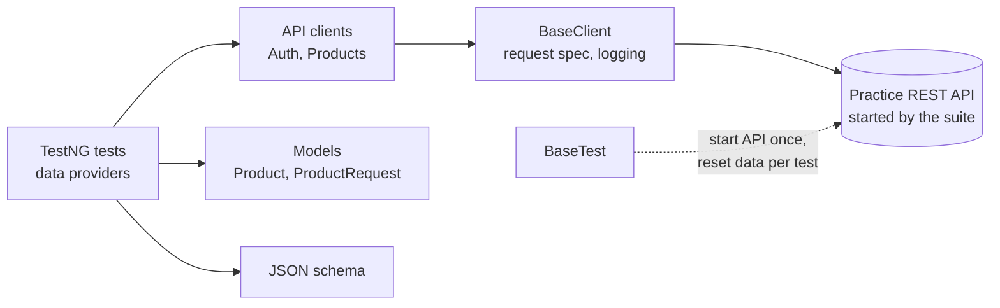

<div align="center">

# 🔗 Rest Assured + TestNG API Framework

**Data-driven API tests for a product catalogue: CRUD, filtering, paging, caching and locking**

    

[](https://github.com/skamirullah/practiceqa-restassured-testng-api/actions/workflows/ci.yml)  

[What it tests](#-what-it-tests) · [Quick start](#-quick-start) · [How it is built](#-how-it-is-built) · [Structure](#-project-structure) · [Reports](#-reports-and-debugging)

</div>

---

## 👋 Overview

An API automation framework built on Rest Assured and TestNG. It tests a product catalogue end to end, from simple reads to the parts that are easy to get wrong: validation, pagination, ETag caching and optimistic locking.

|  |  |
|---|---|
| **App under test** | [Practice REST API](https://www.practiceqaautomation.com/api-practice): the product catalogue |
| **Kind of testing** | API, test-driven (TDD) style with TestNG |
| **Tests** | 26 tests |
| **Runs in** | Any machine with Java and Node.js; the API runs locally |

### Highlights

- **Self-contained.** The suite downloads, starts and stops the API under test by itself.
- **Data-driven.** TestNG data providers cover filters and invalid payloads without copy-paste.
- **Typed models.** Java records for requests and responses, with a builder-style `ProductRequest`.
- **Contract check.** Created products are validated against a JSON schema.

## 🎯 What it tests

| Area | What is checked |
|---|---|
| Listing | First page, page size, total count and the `X-Total-Count` header |
| Pagination | Walking every page returns each product exactly once |
| Filtering and search | Category, in stock, price range, combined filters, case-insensitive search |
| Sorting | `sort=-price` lists the most expensive first |
| Create | 201 with a `Location` header, schema-valid body, readable afterwards |
| Authorisation | 401 without a token, 403 for a customer, 409 for a duplicate SKU |
| Validation | Each invalid field is rejected with 422 and named in the error |
| Update and delete | PATCH changes only what is sent, PUT replaces, DELETE removes |
| Caching and locking | ETag and 304, new ETag on change, 412 on a stale `If-Match` |

## 🚀 Quick start

**You need:** Java 17+ and Maven 3.9+. Node.js 20+ to run the API under test.

```bash
git clone https://github.com/skamirullah/practiceqa-restassured-testng-api.git
cd practiceqa-restassured-testng-api
mvn test
```

| Command | What it does |
|---|---|
| `mvn test` | Run the full regression suite |
| `mvn test -Dsuite=testng-smoke.xml` | Run only the smoke tests |
| `mvn test -Dtest=ProductCrudTests` | Run one test class |
| `mvn test -Dapi.url=http://localhost:4000` | Test an API you started yourself |
| `mvn allure:serve` | Open the Allure report |

> The suite downloads the practice API on first run, starts it on a local port, and stops it when the run ends. You do not need to start anything yourself.

## 🧱 How it is built



- **Client layer.** Tests call `products.create(token, request)`; URLs and headers live in the clients.
- **Start from valid, change one thing.** `ProductRequest.valid().withPrice(-10)` shows exactly what a test varies.
- **Independent tests.** `BaseTest` resets the API's data before every test.
- **AssertJ for collections.** Checks like `isSortedAccordingTo` and `doesNotHaveDuplicates` read as sentences.
- **Allure steps.** Client methods are annotated with `@Step`, so reports show the business action, not just the HTTP call.

## 📁 Project structure

```text
src
├── main/java/com/practiceqa/api
│   ├── client/                     # BaseClient, AuthClient, ProductsClient, UtilityClient
│   ├── model/                      # Product, ProductRequest
│   ├── config/Config.java          # settings from -D flags, env vars, then config.properties
│   ├── data/User.java              # seeded accounts
│   └── server/PracticeApiServer.java   # downloads, starts and stops the API under test
└── test
    ├── java/com/practiceqa/api
    │   ├── base/BaseTest.java
    │   └── tests/                  # CatalogueTests, ProductCrudTests, CachingAndLockingTests
    └── resources
        ├── schemas/product.json
        └── config.properties
testng.xml                          # full regression
testng-smoke.xml                    # smoke group only
```

## ⚙️ Configuration

Defaults live in `src/test/resources/config.properties`. Override any of them on the command line (`-Dapi.port=4201`) or with an environment variable (`API_PORT=4201`); nothing needs editing to change environment.

| Setting | Default | What it does |
|---|---|---|
| `api.url` | empty | URL of an API that is already running. Empty lets the suite start its own. |
| `api.port` | see file | Port the suite starts the practice API on. |
| `api.download` | the live site | Where the practice API file is downloaded from. |

## 📊 Reports and debugging

- **Allure**: run `mvn allure:serve` after a test run for a report with steps, timings and attachments. Every request and response is attached.
- **Surefire**: `target/surefire-reports/` holds the TestNG HTML and XML results.
- **Console**: a failing assertion prints the full request and response.

## 🔁 Continuous integration

[GitHub Actions](.github/workflows/ci.yml) sets up Java and Node.js, runs the suite on every push and pull request, and uploads the results.

## 🧪 About the app under test

The [Practice REST API](https://www.practiceqaautomation.com/api-practice) is a fake shop API with logins, products and orders. It is one dependency-free Node.js file that runs on your own computer, so tests can create, change and delete data freely.

[PracticeQAAutomation](https://www.practiceqaautomation.com) is a free practice site for QA engineers, with realistic apps to automate with Selenium, Playwright and Cypress. All data in these tests is fictional.

## 👤 Author

**Sk Amir Ullah** · Technical Lead, SDET and Test Automation

[Portfolio](https://skamirullah.com) · [LinkedIn](https://linkedin.com/in/skamirullah) · [GitHub](https://github.com/skamirullah) · [PracticeQAAutomation](https://www.practiceqaautomation.com)

## 📄 License

[MIT](LICENSE)
